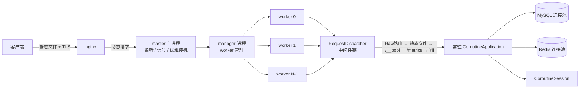
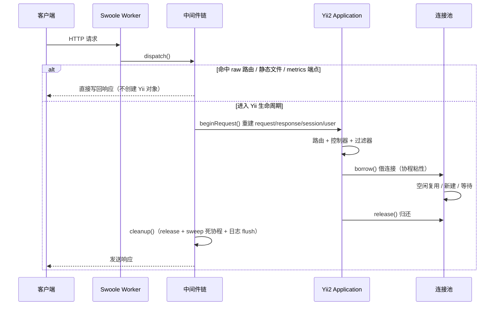
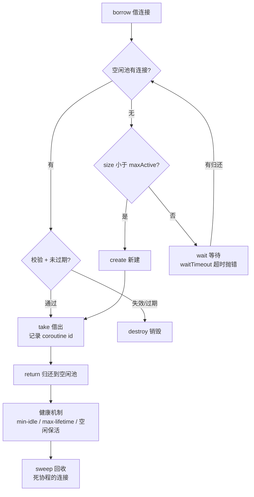
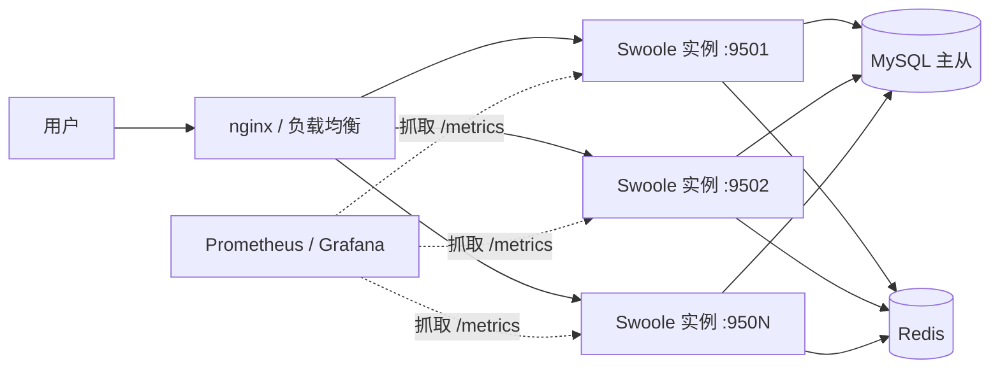

# Yii2S Swoole — Yii2 协程加速器

让 Yii2 应用运行在 **Swoole 6 常驻内存协程 HTTP 服务器**上：数据库/Redis 连接池化复用、
每请求状态隔离、优雅停机、守护化命令、内置压测器。业务代码基本不用改——换掉配置里的
组件类即可。

```json
{"app":"yii2s-example","engine":"swoole-coroutine","php":"8.4.14","swoole":"6.2.0","pid":757,"cid":5}
```

**能力一览**

| 领域 | 特性 |
|---|---|
| 核心 | 多进程 `Swoole\Http\Server`（`worker_num = CPU 核数`）、协程连接池、每请求状态隔离、优雅停机/热重载 |
| 性能 | 路由缓存、单飞锁（thundering herd 抑制）、raw 路由极简通道、内置压测器 |
| 观测 | `/metrics`（Prometheus：RED + 池 + 进程 + 跨 worker 聚合 + 系统负载）、`/__pool`、`swoole/status` 运行时面板 |
| 韧性 | 熔断器、限流、重试、连接池健康机制（min-idle / max-lifetime / 空闲保活）、DB 断线自愈 |
| 运维 | `swoole/start|stop|reload|check|status|routes`、`queue/serve`、长跑检漏脚本、watch 热重载 |
| 调度 | 秒级定时任务（crontab） |

基准（macOS + swoole-cli，12 worker，keep-alive，100 并发 5s）：纯框架 **24832 QPS**（p50 2.94ms）/
带 DB 查询 **10294 QPS** / 带 Redis **7766 QPS**，连接池零超时零泄漏，详见
[`doc/DEVELOPMENT.md`](doc/DEVELOPMENT.md) 的压测章节。

上生产前的工程硬化计划见 [`doc/ROADMAP.md`](doc/ROADMAP.md)。

---

## 环境要求

| 依赖 | 版本 |
|---|---|
| PHP | >= 8.4（实测 8.4 / 8.5） |
| ext-swoole | ^6.0（Swoole Http Server + 连接池） |
| yiisoft/yii2 | ^2.0 |
| ext-redis | 原生 phpredis，使用 `redis`/`cache`/`session`/`queue` 组件时必需（`yii2-redis` 是纯 PHP 客户端，不提供 `\Redis`） |
| MySQL / Redis | 可选，按使用的组件而定 |

> **目标平台是 Linux**（生产环境）；macOS 可开发（pecl 编译安装即可）。
> 两种安装方式：标准 `pecl install swoole`，或
> [swoole-cli](https://www.swoole.com/page/download)（自带全部扩展的独立二进制，
> 免配置，Linux 上开箱即用）。

## 安装

```bash
composer require easydowork/yii2s
```

发布 Packagist 前可通过 path 仓库引入：

```json
"repositories": [
    {"type": "path", "url": "../yii2s", "options": {"symlink": true}}
]
```

## 5 分钟跑起来（example 目录）

```bash
# 1. 初始化演示数据库（建库建表插数据，需要本地 MySQL）
php example/init-db.php

# 2. 启动服务器
php example/yii swoole/start

# 3. 访问
curl http://127.0.0.1:9501/
curl http://127.0.0.1:9501/demo/db
```

## 架构一览

### 进程模型与请求流



### 单请求生命周期



### 连接池工作流



### 生产部署拓扑



设计原则：**状态隔离做在调度层，上层 Yii2 组件尽量不改**——这也是 CSRF、Basic Auth、
事务、MULTI 无需适配就能用的原因。完整的组件替换对照表和踩坑记录见
[`doc/DEVELOPMENT.md`](doc/DEVELOPMENT.md)。

---

## 接入现有 Yii2 应用

### 方式一：一行接入（推荐）

现有 Yii2 应用只需在 `bootstrap` 里加一条——**其余零改动**：

```php
// config/web.php
return [
    'bootstrap' => [
        ['class' => \Yii2S\Swoole\Bootstrap::class],
    ],
    // 你已有的 request/response/db/redis 配置原样保留：
    // Bootstrap 会把 stock 类（yii\web\Request、yii\db\Connection、
    // yii\redis\Connection ...）自动替换为协程版，所有参数原封不动；
    // 没有显式配置 swooleHttpServer 时会注册一个默认服务器组件
    //（127.0.0.1:9501，dispatcher 指向 @app/config/web.php）。
];
```

```bash
php yii swoole/start        # 就这么跑起来了
```

> 注意：服务器进程会 `require` 这个 config 文件两次（控制台入口一次、请求分发一次），
> 配置里不要写带副作用的顶层代码。

### 方式二：显式配置（完全控制）

```php
'request' => [
    'class' => \Yii2S\Swoole\Runtime\CoroutineRequest::class,
    'cookieValidationKey' => '...',
    'enableCsrfValidation' => true,       // CSRF 完整可用
],
'response' => [
    'class' => \Yii2S\Swoole\Runtime\CoroutineResponse::class,
],
'log' => [
    'targets' => [[
        'class' => \Yii2S\Swoole\Log\CoroutineFileTarget::class,  // 缓冲批量写
        'maxBufferMessages' => 100,
        'logFile' => '@app/runtime/logs/app.log',
    ]],
],
'db' => [
    'class' => \Yii2S\Swoole\Db\CoroutineDbConnection::class,
    'dsn' => 'mysql:host=127.0.0.1;dbname=app',
    'username' => '...', 'password' => '...',
    'poolMaxActive' => 20,            // 池容量：并发查询的硬上限
    'poolWaitTimeout' => 3.0,         // 借不到连接的等待秒数
    'poolMinIdle' => 2,               // 最小空闲水位（配合服务器定时 keeper）
    'poolMaxLifetime' => 300,         // 连接最长存活秒数（到期回收，0 关闭）
    'poolIdleTimeout' => 60,          // 空闲超时重校验（配合 enableHealthCheck）
    'enableHealthCheck' => true,      // 借出前 SELECT 1 校验
    'slowQueryThreshold' => 0.5,      // 慢查询日志阈值秒（0 关闭）
    'enableCircuitBreaker' => true,   // 熔断：连续连接失败后快速失败
    'circuitFailureThreshold' => 5,
    'circuitCooldown' => 30,
    'enableSchemaCache' => true,      // 表结构缓存：information_schema 只查一次
    'schemaCache' => 'cache',         // 指向一个协程 Redis 缓存组件
    'schemaCacheDuration' => 3600,    // 表结构缓存有效期秒
],
'redis' => [
    'class' => \Yii2S\Swoole\Redis\CoroutineRedisConnection::class,
    'hostname' => '127.0.0.1',
    'poolMaxActive' => 20,
    'enableCircuitBreaker' => true,
],
'urlManager' => [
    'class' => \Yii2S\Swoole\Runtime\CoroutineUrlManager::class,  // 路由缓存（规则多时省 CPU）
    'enablePrettyUrl' => true,
    'showScriptName' => false,
],
'swooleHttpServer' => [
    'class' => \Yii2S\Swoole\Server\HttpServer::class,
    'host' => '127.0.0.1',
    'port' => 9501,
    'pidFile' => '@app/runtime/swoole-server.pid',
    'documentRoot' => '@app/public',           // 可选：静态文件（开发环境）
    'prewarmConnections' => 2,                // 预热连接池，避免冷启动连接风暴
    'poolMaintenanceInterval' => 30.0,        // 连接池健康 keeper 间隔（0 关闭）
    // Swoole 内部日志（worker 崩溃/端口冲突/send 失败等）。默认：系统临时目录
    // yii2s-swoole-<uid>/swoole-<host>-<port>.log + 每日轮转；设为 false 则仅输出
    // stdout（容器采集场景）；settings 里的 log_file/log_level 键优先级更高
    'logFile' => '@app/runtime/logs/swoole.log',
    'logLevel' => SWOOLE_LOG_WARNING,
    'dispatcher' => new \Yii2S\Swoole\Server\RequestDispatcher('@app/config/web.php', [
        'enablePoolMetricsEndpoint' => true,  // /__pool
        'enableMetricsEndpoint' => true,      // /metrics
        'enableMetricsAggregation' => true,   // /metrics 跨 worker 聚合（Redis）
    ]),
],
```

两种方式下，cache / session / queue 都需要显式协程类（无 stock 对应物可自动替换）：

```php
'cache' => [
    'class' => \Yii2S\Swoole\Cache\CoroutineRedisCache::class,
    'redis' => 'redis',               // getOrSet 自带单飞锁，冷缓存不惊群
],
'session' => ['class' => \Yii2S\Swoole\Session\CoroutineSession::class, 'redis' => 'redis'],
'queue' => [
    'class' => \Yii2S\Swoole\Queue\CoroutineRedisQueue::class,
    'redis' => 'redis',
    'channel' => 'default',
    'ttr' => 60,                  // 失败任务重试延迟
    'maxAttempts' => 3,           // 超过则进死信列表
    'handler' => function (array $payload): void {
        // 处理任务
    },
],
```

`request/response/session/user` 由框架每请求自动重建，原版 `yii\web\User`、
`yii\filters\auth\HttpBasicAuth` 等直接可用。Redis 的 MULTI/PIPELINE、
DB 的事务也都原生支持（连接在协程内粘性借用）。

## 极简接口快速通道（raw 路由）

健康检查、指标、极简只读接口这类请求，可以注册 **raw 路由**：命中后**不创建 Yii 的
request/response**，直接写回 Swoole 响应：

```php
'swooleHttpServer' => [
    'class' => \Yii2S\Swoole\Server\HttpServer::class,
    'documentRoot' => '@app/web',
    'dispatcher' => (new \Yii2S\Swoole\Server\RequestDispatcher(__DIR__ . '/web.php', [
        'enablePoolMetricsEndpoint' => true,
    ]))
        ->addRawRoute('GET', '/ping', static fn (): string => 'pong')
        ->addRawRoute('GET', '/health', static fn (): array => ['ok' => true]),
],
```

- 返回值：`string` → `text/plain`；`array` → `application/json`；`null` → handler 自己
  操作 Swoole response（签名 `(Request $request, Response $response)`）。
- 精确匹配 `METHOD + path`，query 不参与匹配；方法不匹配会**回落**到 Yii 路由。
- **绕过 Yii**：不经过路由、session、CSRF、用户认证。只放公开/无状态端点。
- 微基准：raw 路由约 4 万 QPS，接近裸 Swoole；完整 Yii 生命周期约 2.3 万 QPS（100 并发 5s，见压测章节）。

## 控制台命令

```bash
php yii swoole/start [--host=] [--port=] [--watch]  # 启动（阻塞），写 pid 文件
php yii swoole/status                               # 运行时面板：worker 数/内存/协程数/连接数/请求
php yii swoole/routes                               # 列出 raw 路由 + urlManager 规则
php yii swoole/stop                                 # 优雅停机（在途请求排空后退出）
php yii swoole/reload                               # 优雅重载 worker（SIGUSR1：加载新代码，master 不变，在途请求不中断）
php yii swoole/check                                # 配置体检（Application 隔离、cookie key、prettyUrl、db/redis 探活）
php yii queue/serve [--limit=N]                     # 队列消费 worker（无限轮询）
```

`status` 输出示例：

```
Server is running: pid 84268, listening on 127.0.0.1:9601, started ... (1s ago)
  workers: 12, memory: 47.1 MB (process tree RSS)
  requests: 7 (errors 0) [single worker]
  coroutines: 1 [single worker]
  db: 0 active / 1 idle (created 1, timeouts 0, discarded 0)
  redis: 0 active / 0 idle (created 0, timeouts 0, discarded 0)
```

> `status` 里的请求/协程/连接数是**单 worker 快照**（`/metrics`、`/__pool` 由随机 worker
> 处理）；内存和 worker 数是全量（进程树 RSS）。要全量聚合用 `/metrics`（见下）。

### 开发热重载

```bash
php yii swoole/start --watch
```

修改 `@app` 下的 PHP 文件后，服务器**自动优雅重启**并加载新代码（约 1 秒内完成，
在途请求不中断）。轮询 mtime 实现、零外部依赖。**开发专用**——重启进程，生产禁止。

## 观测与运维

### `/metrics`（Prometheus）

```bash
# 配置 dispatcher: enableMetricsEndpoint => true
curl http://127.0.0.1:9501/metrics
```

输出：请求量/状态码（`yii2s_http_requests_total`）、耗时直方图、池状态、进程内存/协程、
系统负载（`yii2s_process_load_average`，Linux）。启用 `enableMetricsAggregation => true`
后，指标**跨 worker 聚合**（Redis），`yii2s_process_memory_bytes` 带 `worker=` 标签。

### `/__pool`（连接池）

```bash
# 配置 dispatcher: enablePoolMetricsEndpoint => true
curl http://127.0.0.1:9501/__pool
```

### 长跑检漏 + 压测

```bash
swoole-cli scripts/bench.php --path=/demo/db --concurrency=100 --duration=5   # 协程压测器
swoole-cli scripts/soak.php --path=/demo/db --duration=60 --pid=<server pid>   # 长跑检漏：RSS/池漂移
```

## 韧性组件

| 组件 | 作用 | 配置 |
|---|---|---|
| `CircuitBreaker` | 依赖故障时快速失败，避免 500 连击 | DB/Redis 的 `enableCircuitBreaker` 等 |
| `RateLimiter` | Redis 固定窗口限流 | `new RateLimiter($redis)->allow($key, $limit, $window)` |
| `Retry` | 指数退避重试 + 可重试异常白名单 | `(new Retry())->call($fn, $attempts, [Timeout::class])` |
| 连接池健康 | min-idle 水位 / max-lifetime 回收 / 空闲保活 | `poolMinIdle`/`poolMaxLifetime`/`poolIdleTimeout` |
| DB 断线自愈 | 连接丢失自动 discard，下个请求重建 | 内置于 `CoroutineCommand` |
| 单飞锁 | `getOrSet` 冷缓存并发 miss 只跑一次回调 | 内置于 `CoroutineRedisCache` |

```php
// 熔断
use Yii2S\Swoole\Resilience\CircuitBreaker;
$breaker = new CircuitBreaker(5, 30);           // 5 次失败打开，30s 冷却
$result  = $breaker->call(fn () => $api->fetch(), fn () => $fallback);

// 限流
use Yii2S\Swoole\Resilience\RateLimiter;
if (!(new RateLimiter(Yii::$app->redis))->allow($ip, 100, 60)) {
    throw new \yii\web\TooManyRequestsHttpException();
}

// 重试
use Yii2S\Swoole\Resilience\Retry;
$result = (new Retry())->call(fn () => $rpc->call(), 3, [TimeoutException::class]);
```

## 定时任务（crontab）

秒级定时任务（对标 Hyperf/crontab），`@every Ns` 或标准 5 字段 cron：

```php
use Yii2S\Swoole\Scheduling\Crontab;
use Yii2S\Swoole\Scheduling\CrontabDispatcher;

$dispatcher = new CrontabDispatcher();
$dispatcher->add(new Crontab('清理过期会话', '@every 5m', fn () => Session::gc()));
$dispatcher->add(new Crontab('每日汇总', '0 2 * * *', fn () => Stats::aggregateDaily()));

// 在 workerStart 的协程里每秒 tick 一次（或在独立协程里 run()）
\Swoole\Coroutine::create(fn () => $dispatcher->run());
```

## 生产部署（Linux）

标准架构：**nginx 直接服务静态文件 + TLS，Swoole 只处理动态请求**。

多核部署用 **多端口 + nginx upstream**（每个实例一个端口，各自独立的 pid 文件）：

```ini
; supervisor: 4 个实例分别监听 9501-9504
[program:yii2s]
command=swoole-cli /app/yii swoole/start --host=127.0.0.1 --port=950%(process_num)02d
process_name=%(program_name)s_%(process_num)02d
numprocs=4
autorestart=true
stopsignal=TERM
stopwaitsecs=25                ; 必须大于 gracefulTimeout(10s)，留出排空时间
```

> 多实例只推荐「多端口 + nginx upstream」这一种形态；真实客户端 IP（`trustedProxies`）、
> 超时、上传大小等生产清单见 [`doc/DEVELOPMENT.md`](doc/DEVELOPMENT.md) 部署章节。

## 已知限制

- 需要 `urlManager.enablePrettyUrl = true`（`?r=` 路由依赖 `$_GET`，协程不安全）
- `Http\Server` 不使用 Swoole 原生 `enable_static_handler`，静态文件走 PHP 层
  （`documentRoot`，开发用）或交给 nginx（生产推荐）
- 不要在常驻进程中使用 `$_SESSION`/`header()`/`setcookie()` 等超全局/过程式 API，
  一律走 `Yii::$app->request/response/session`
- 自定义 `Application` 类必须继承 `Yii2S\Swoole\Runtime\CoroutineApplication`，否则
  request/response/session/user 会在并发请求间共享
- 子协程（`Coroutine::create()`）**不继承**协程上下文：在子协程里访问
  `Yii::$app->request/session/user` 会得到该请求之外的空实例。并发子任务请先在
  父协程取出所需数据再传入（DB/Redis 连接池本身不受影响）
- 上传用 `Yii2S\Swoole\Runtime\CoroutineUploadedFile`（官方 `yii\web\UploadedFile` 的
  `saveAs()` 在 Swoole 下会失败，且读进程级 `$_FILES` 并发串文件）：

  ```php
  use Yii2S\Swoole\Runtime\CoroutineUploadedFile as UploadedFile;
  $file = UploadedFile::getInstance($model, 'avatar');
  $file?->saveAs('@app/web/uploads/' . $file->name);
  ```

## 开发与测试

目标平台 Linux；测试可在 Linux 与 macOS（swoole-cli）上完整运行，
全量 **211 tests / 852 assertions**（2 skipped）全绿。

```bash
composer test    # PHPUnit（需要本地 MySQL/Redis）
composer static  # PHPStan level 5
composer cs      # php-cs-fixer（与官方 yii2 同规则）

# 进程级端到端（start/status/reload/SIGTERM）与基准：
bash scripts/e2e.sh
bash scripts/bench.sh
```

### CI（GitHub Actions）

`.github/workflows/ci.yml` 在 push / PR 时自动跑四个 job：

| Job | 覆盖 |
|---|---|
| `phpunit` | PHP 8.4–8.5 矩阵 × 真实 MySQL 8 + Redis 7 × pecl swoole 6.2.x，全量用例 |
| `smoke` | blog demo 端到端（起真实多进程服务器：MVC、错误页、REST API、session+CSRF、上传+静态、CSV 下载、队列、并发） |
| `static` | PHPStan（`--error-format=github`，PR 上直接标注行号） |
| `coding-standard` | php-cs-fixer |

压测章节、组件替换对照表、踩坑记录见 [`doc/DEVELOPMENT.md`](doc/DEVELOPMENT.md)；
组件清单与 API 参考见 [`doc/COMPONENTS.md`](doc/COMPONENTS.md)；
质量硬化路线图见 [`doc/ROADMAP.md`](doc/ROADMAP.md)。

## License

MIT
